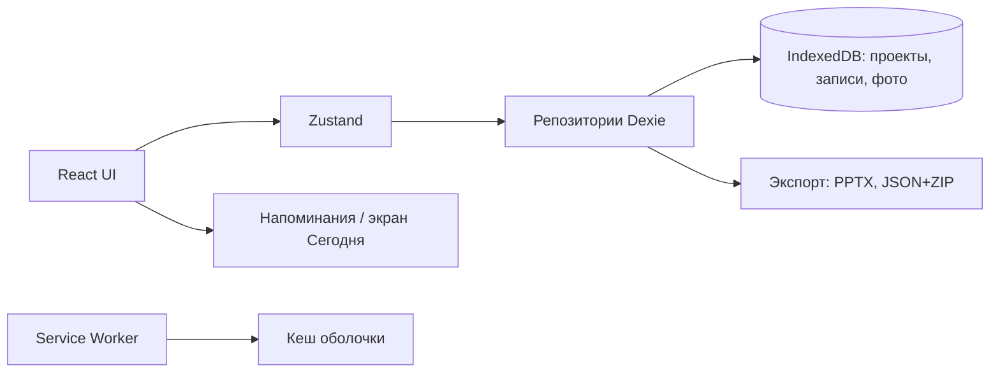

# План разработки: «Дневник наблюдений» (10+)

**Источник:** `dnevnik_nablyudeniy_10plus.md` (рабочая концепция).
**Предмет плана:** первая версия (MVP) для проверки гипотез из раздела 14 концепции.
**Подход:** сначала работающий прототип полного пути «вопрос → наблюдения → сравнение → вывод → презентация», затем расширение.
**Формат работ:** поэтапно, каждый этап заканчивается проверяемым результатом и критериями готовности.

---

## 1. Ключевые решения

### 1.1. Платформа: PWA, сначала компьютер и планшет

Один код — компьютер, планшет и (позже) телефон. Устанавливается как приложение, работает офлайн, не требует магазинов.

**Приоритет устройств: компьютер — основное, планшет — второе, телефон — после MVP.**

| Роль | Устройство | Что делаем на нём |
| --- | --- | --- |
| **Основное** | Компьютер / ноутбук (MacBook, Chrome или Safari) | Создание проекта, вся история, сравнение фото, вывод, сборка и экспорт презентации |
| **Второе** | Android-планшет 10–11", книжная и альбомная ориентация | Наблюдения и фото «на месте», просмотр истории, показ результата с экрана |
| Отложено | Телефон Android / iPhone | Быстрая запись «на ходу» — после MVP. Раскладка не должна ломаться, но в приёмку MVP не входит |

Из этого следует планировка: **основная версия — десктопная**, планшетная — полноценная адаптация, телефонная — «не сломано», без отдельной приёмки. Компьютер в приоритете, потому что за ним удобнее вести проект, сравнивать фото и собирать презентацию, а планшет нужен там, где находится объект наблюдения.

| Ширина | Раскладка | Статус в MVP |
| --- | --- | --- |
| ≥ 1024 px (компьютер, планшет альбомный) | Список + деталь рядом, сравнение фото бок о бок, слайд 16:9 в натуральную величину | Основная, приёмка |
| 768–1024 px (планшет книжный) | Две колонки, боковая навигация-иконки, формы в два столбца | Полная адаптация, приёмка |
| < 768 px (телефон) | Одна колонка, нижняя навигация, крупная кнопка «Добавить» | Поддерживаем работоспособность, приёмки нет |

**Проблема двух устройств.** Данные в v1 хранятся локально, поэтому проект, созданный на компьютере, не появится на планшете сам. Решение для MVP: **один проект — одно основное устройство** (компьютер), а перенос — через экспорт-архив в P7 («Перенести на другое устройство»). Обычно так и получается: проект ведётся за компьютером, планшет используется для съёмки и показа. Подробнее в разделе 4.6.

| Что нужно | Зачем |
| --- | --- |
| HTTPS | Обязательное условие для установки и service worker |
| `manifest.webmanifest` | Название, иконки, цвет темы, `display: standalone` |
| Service worker | Кеш оболочки приложения и офлайн-режим |
| Иконки 192/512 px + maskable | Корректный вид на компьютере и планшете |
| Страница «Добавить на компьютер и планшет» | На Android установка неочевидна, нужна инструкция |

**Как устанавливается:**

- **Компьютер / Chrome или Edge:** иконка установки в адресной строке, приложение открывается в отдельном окне. В Safari на Mac — работа во вкладке.
- **Android-планшет / Chrome:** подсказка «Установить приложение» или меню ⋮ → «Установить приложение». Если подсказки нет: ⋮ → «Добавить на главный экран».
- **Телефон:** те же способы, но проверка и инструкция — после MVP.
- **iPad / iPhone:** не входят в MVP; инструкция появится, если платформа понадобится позже.

**Ограничения, которые учитываем в дизайне:**

- Напоминания в v1 — экран «Сегодня» и локальные уведомления, где браузер их разрешает. Полноценный push требует сервера и появится позже; на Android это реализуемо без магазина приложений.
- Фото: на компьютере — выбор файла и перетаскивание, на планшете и телефоне — `<input type="file" accept="image/*" capture="environment">`. Отдельное приложение не нужно.
- Если позже понадобятся надёжные push, доступ к файловой системе и публикация в App Store / Google Play — тот же код оборачивается в **Capacitor** (после MVP, не входит в первую версию).

### 1.2. Окружение разработки

| Слой | Выбор | Почему |
| --- | --- | --- |
| Сборка | **Vite** | Быстрый старт, простой PWA-плагин, статичная сборка |
| UI | **React + TypeScript** | Предсказуемость, много готовых компонентов, легко поддерживать |
| Стили | **Tailwind CSS + shadcn/ui** | Быстрая адаптивная вёрстка, крупные элементы под детскую аудиторию |
| Шрифты | **Nunito Variable + Comfortaa Variable** (self-hosted через Fontsource) | Округлые дружелюбные формы, кириллица, работают офлайн |
| Роутинг | React Router | Простые экраны, deep link на проект |
| Состояние | Zustand | Минимум кода, без бойлерплейта |
| Формы и валидация | React Hook Form + Zod | Одна схема валидации для формы и данных |
| Хранилище | **IndexedDB через Dexie** | Фото и записи локально, работает офлайн, без сервера |
| PWA | `vite-plugin-pwa` (Workbox) | Manifest, service worker, обновления |
| Даты | date-fns + ru-локаль | Лёгкий, без moment.js |
| Графики | Recharts (или собственный SVG-график) | Простые графики измерений |
| Презентации | **PptxGenJS** | Генерация редактируемого PPTX в браузере |
| Экспорт/бэкап | JSZip + `file-saver` | Архив JSON + фото для сохранности данных |
| Тесты | Vitest (логика) + Playwright (сценарии) | Проверка расчётов и основного пути |
| Качество кода | ESLint + Prettier, strict TypeScript | Единый стиль |
| Деплой | **Cloudflare Pages** или Vercel | Бесплатный HTTPS-хостинг, превью на каждый коммит |
| Аналитика | Не подключаем в v1 (или Plausible без cookie) | Приватность детских данных |

**Локальная среда:** macOS, Node.js LTS, pnpm, VS Code, Chrome и Chrome DevTools — основная площадка разработки и проверки. Safari на Mac — по желанию, для будущей iOS-версии.

**Бэкенда в v1 нет.** Все данные — на устройстве пользователя. Это осознанное решение: приватность, отсутствие затрат, быстрый старт. Синхронизация и аккаунты — отдельный этап после проверки идеи.

### 1.3. Как проверяем, пока нет планшета

Основное устройство — компьютер, он доступен с первого дня, поэтому большая часть проверок закрывается сразу. Целевой планшет — **Android**, и это упрощает дело: Chrome на планшете и Chrome на Mac — один движок. Поэтому эмуляция в DevTools даёт более точную картину, чем для iPad, а Xcode и iPad Simulator не нужны.

**Что проверяется на MacBook:**

| Способ | Что даёт |
| --- | --- |
| Chrome на Mac, окно 1280 / 1440 px | Основная десктопная раскладка, реальная работа мышью и клавиатурой |
| Chrome DevTools → Device Toolbar | Android-планшеты: Pixel Tablet 1280 × 800, Galaxy Tab S9 1600 × 2560, Galaxy Tab A 1200 × 1920 — с поворотом экрана |
| Chrome DevTools → Touch emulation | Тап-зоны, свайпы, отсутствие hover-зависимых элементов |
| Chrome → меню → «Установить приложение» | Настоящая установка PWA на Mac, отдельное окно, офлайн-запуск |
| Chrome DevTools → Network/CPU throttling | Поведение на слабом планшете и медленной сети |
| Chrome DevTools → Application → Storage | IndexedDB, кеш service worker, «Clear storage» как тест первого запуска |
| Lighthouse (desktop и mobile) | Installable, производительность, доступность |
| Playwright: профили 1440 и 1024 px | Автотесты основного пути на компьютере и планшете |
| Chrome на реальном Android-планшете | Как только устройство появится — проверка по превью-ссылке, не дожидаясь P8 |

**Что на MacBook проверить нельзя** (переносится в P8):

- реальная камера планшета и выбор снимка из галереи;
- подсказка установки и поведение иконки на Android;
- поведение при нехватке места в хранилище;
- реальные уведомления и системные разрешения;
- скорость сжатия фото и прокрутка истории на слабом планшете;
- поведение в альбомной ориентации на устройстве с чехлом и подставкой.

**Что делаем заранее, чтобы не поймать это в конце:**

- Публичная превью-ссылка с первого этапа: Android-планшет открывает её без сборки проекта. Проверку на реальном планшете можно делать раньше P8, как только он окажется под рукой.
- Только `<input type="file">` для фото, без `getUserMedia`; на компьютере дополнительно drag & drop.
- С первого дня: адаптив от десктопа, `dvh` вместо `100vh`, `env(safe-area-inset-*)`, тап-зоны ≥ 44 px, проверка обеих ориентаций.
- Никаких hover-only действий: всё, что на компьютере открывается по наведению, на планшете должно открываться тапом.
- Телефонную раскладку не приёмка, но и не ломаем: `< 768 px` держим работоспособной, чтобы вернуться к ней после MVP без переделки.
- `navigator.storage.persist()` и индикатор занятого места — чтобы данные не пропали.
- Chrome на Android — целевой браузер. Samsung Internet и другие оболочки проверяем по остаточному принципу, если планшет их использует по умолчанию.

### 1.4. Что входит в MVP

Из раздела 12 концепции — пять частей:

1. **Проект:** название, объект, вопрос, срок, 3 шаблона (животное, растение, погода) + универсальный.
2. **Наблюдение:** фото, текст, быстрые отметки, числовые показатели.
3. **История:** лента, отметка важных событий, сравнение двух фото.
4. **Напоминания:** расписание наблюдений, список действий по уходу, перенос, пауза.
5. **Результат:** выбор материалов, ввод вывода, предпросмотр и экспорт PPTX.

### 1.5. Что НЕ входит в MVP

Голосовой ввод и распознавание речи, «письмо себе в будущее», графики*, помощь при повторной съёмке, отметки поверх фото, коллекция открытий, дополнительные шаблоны, PDF/постер/фотоальбом, доступ учителю и совместные проекты, ИИ, распознавание видов, аккаунты и облако.

\* Простой график числового показателя — пограничный пункт: включаем, только если остаётся время на этапе 4. Иначе переносим.

---

## 2. Пользовательские сценарии MVP

| № | Сценарий | Результат |
| --- | --- | --- |
| S1 | Первый запуск → выбор шаблона → создание проекта | Проект открыт, виден вопрос и первый шаг |
| S2 | Быстрая запись: фото + заметка + отметка | Запись в ленте, время наблюдения сохранено |
| S3 | Запись с измерениями | Число с единицей сохранено, предыдущее значение предложено |
| S4 | «Не наблюдал» / «Изменений не заметил» | Корректный тип записи, пропуск не считается наблюдением |
| S5 | Просмотр истории и сравнение двух фото | Даты видны, снимки рядом |
| S6 | Отметка «важное событие» и выбор материалов | Материалы попали в подборку для презентации |
| S7 | Формулировка вывода с привязкой к записям | Вывод сохранён, ссылки на записи работают |
| S8 | Сборка и экспорт презентации | Скачан открывающийся PPTX из 6 слайдов |
| S9 | Напоминание, перенос, пауза, завершение проекта | Расписание меняется, уведомления прекращаются |
| S10 | Установка на компьютер и планшет, повторное открытие офлайн | Приложение открывается, данные на месте |
| S11 | Перенос проекта между устройствами через архив | Проект с фото открывается на другом устройстве |

**Главный проверяемый путь (must work):** S1 → S2 → S5 → S7 → S8.

---

## 3. Экраны

| Экран | Содержание | Компьютер (основной) | Планшет |
| --- | --- | --- | --- |
| Старт / полка | Список проектов, обложки, «Создать проект» | Сетка 3 колонки + блок последних записей | Сетка 2 колонки |
| Выбор шаблона | 4 карточки с примерами вопросов | Сетка 4 в ряд | Сетка 2 × 2 |
| Создание проекта | Название, объект, вопрос, срок, обложка (постепенно) | Два столбца + предпросмотр карточки | Два столбца, компактнее |
| Проект (обзор) | Обложка, вопрос, прогресс, «Добавить наблюдение», «Сегодня» | Три зоны: проект, вопрос, последние записи | Обзор + записи ниже |
| Новое наблюдение | Дата/время, фото, заметка, отметки, измерения, «важное» | Фото и поля рядом, без прокрутки | Фото сверху, поля ниже, прокрутка допустима |
| История | Лента по датам, фильтр по типу, переход к сравнению | Фильтры слева, сетка фото 4 в ряд | Сетка 2–3 в ряд, фильтры сверху |
| Сравнение | Два фото рядом, выбор пары, подписи | Крупно бок о бок, переключение ползунком | Бок о бок на всю ширину |
| Вывод | Текст вывода + выбор подтверждающих записей | Текст слева, записи справа | Текст сверху, записи ниже |
| Презентация | Предпросмотр слайдов, выбор материалов, оформление, экспорт | Слайд 16:9 + панель слайдов + свойства | Слайд по ширине + панель слайдов снизу |
| Напоминания | Расписание наблюдений, действия по уходу, пауза | Календарь недели | Список недели |
| Настройки проекта | Режим, тема, срок, экспорт/бэкап, удаление | Двухколоночная форма | Одноколоночная форма |
| Помощь | «Как установить», подсказки, приватность | Две колонки | Одна колонка |

Навигация: **компьютер** — боковая панель со списком проектов и разделами; **планшет** — боковая панель с иконками; **телефон** — нижняя панель (Проект, История, Добавить, Результат), но это вне приёмки MVP.

---

## 4. Техническая архитектура



Слои:

- `domain` — типы, шаблоны, расчёт расписания, статистика, сборка структуры презентации (чистая логика, покрывается тестами).
- `data` — Dexie-схема, репозитории, миграции версий БД.
- `ui` — экраны, компоненты, дизайн-система.
- `services` — сжатие фото, экспорт PPTX, бэкап, уведомления.

### 4.1. Модель данных

```ts
Project {
  id, title, subjectName, templateId, mode: 'quick' | 'research',
  coverPhotoId?, description?, question?, hypothesis?,
  startDate?, endDate?, theme: { color, cover },
  status: 'active' | 'paused' | 'completed' | 'archived',
  createdAt, updatedAt
}

Template { id, title, exampleQuestion, quickMarks[], metricPresets[], hints[] }

Metric { id, projectId, name, unit, type: 'number', order }

Observation {
  id, projectId, kind: 'observation' | 'no_changes' | 'skipped' | 'care',
  observedAt,            // фактическое время наблюдения
  createdAt,             // время добавления — всегда отдельно
  note?, photoIds[], markIds[], measurements[{ metricId, value }],
  isImportant: boolean, careActionId?
}

Photo { id, projectId, blob, thumbBlob, width, height, createdAt }

Mark { id, projectId, label, emoji? }        // быстрые отметки из шаблона

Reminder {
  id, projectId, kind: 'observation' | 'care',
  careActionId?, title, daysOfWeek[], time, everyNWeeks,
  enabled, snoozedUntil?, lastDoneAt?
}

Conclusion { id, projectId, text, observationIds[], createdAt }

ExportRecord { id, projectId, format: 'pptx', createdAt, slideIds[] }
```

Правила:

- Фото — `Blob` в IndexedDB, не base64 в основном хранилище (экономия памяти).
- Перед сохранением фото сжимается до 1600 px по длинной стороне, JPEG ~0.8, плюс превью 320 px.
- Удаление проекта удаляет связанные фото и записи одним действием.
- Пропуск (`skipped`) никогда не участвует в расчётах как наблюдение.

### 4.2. Экспорт PPTX

- 16:9, шаблон из 6 слайдов (см. раздел 8 концепции).
- Слайды собираются из выбранных пользователем материалов; недоступные блоки (график, гипотеза) просто не добавляются.
- Кириллица: только безопасные шрифты (Arial / Verdana), размеры и переносы проверяются на реальном PowerPoint.
- Генерация в Web Worker, чтобы не блокировать интерфейс; крупные фото — уже сжатые.
- Пустое состояние: если материалов мало, экспорт предлагает минимальный вариант из 3 слайдов и не падает.

### 4.3. Напоминания — принятое решение

| Вариант | Плюсы | Минусы | Решение |
| --- | --- | --- | --- |
| Только экран «Сегодня» | Работает везде, без разрешений | Нет уведомлений | **База v1** |
| Web Push + бэкенд | Работает на Android и iOS 16.4+ | Нужен сервер, подписки, VAPID | После MVP |
| Capacitor + локальные уведомления | Надёжно, точное время, магазины | Сборка под платформы | После MVP, при необходимости |

В v1: расписание хранится, экран «Сегодня» показывает задачи, есть запрос разрешения на уведомления и показ локального уведомления при открытом приложении. Ограничение честно описано в интерфейсе.

### 4.4. Приватность и доступ

- Нет аккаунтов и серверной передачи данных в v1.
- Нет обязательного поля с адресом; место — свободный текст («двор», «балкон»).
- Очистка данных — явная, с подтверждением.
- Бэкап: экспорт архива (JSON + фото) и импорт, а также перенос проекта между устройствами — на этапе P7.
- Тексты для родителей/учителя: что хранится, где и как удалить.

### 4.5. Требования к интерфейсу

- **Компьютер — основная раскладка.** Проектируем от окна 1280–1440 px, затем адаптируем под планшет от 1280 × 800 в альбомной и 800 × 1280 в книжной.
- Планшет: обе ориентации, без потери функций и без «прыжков» при повороте.
- Телефонная раскладка (< 768 px) обязана оставаться работоспособной, но не входит в приёмку MVP.
- Тап-зоны ≥ 44 px, базовый шрифт ≥ 16 px; на планшете элементы управления крупнее, чем на компьютере.
- Контраст не ниже WCAG AA; никаких «мелких серых» подписей.
- Добавление наблюдения: на компьютере ≤ 1 минуты, на планшете ≤ 2 минут, до 3 экранов.
- Подсказки скрываемые, тексты короткие и уважительные, без сюсюканья.
- Понятные пустые состояния и состояния ошибок (нет камеры, нет места, нет сети).
- Предпросмотр презентации на компьютере и планшете — 16:9, чтобы оценить слайд до экспорта.

### 4.6. Два устройства и перенос данных

Данные в v1 локальные, поэтому компьютер и планшет — два независимых хранилища. В первой версии принимаем простое правило: **один проект живёт на одном устройстве**. Обычно это компьютер: за ним ведётся проект, сравниваются фото и собирается презентация. Планшет нужен, чтобы снять объект на месте, посмотреть историю и показать результат; он может вести и собственный проект.

Перенос между устройствами — вручную, через архив:

1. На исходном устройстве: «Настройки проекта» → «Перенести проект» → скачивается файл `.zip` (JSON + фото).
2. На другом устройстве: «Создать проект» → «Импортировать архив» → выбор файла.
3. Импорт проверяет версию формата и не дублирует уже существующий проект.

Это неудобно, но честно и не требует сервера. Синхронизация между устройствами — в бэклоге после MVP; до неё правило «одно устройство — один проект» должно быть написано в интерфейсе, чтобы не было потерянных записей.

---

## 5. Этапы разработки

Оценки — для одного разработчика с ИИ-помощником. «День» = 6–8 часов.
Компьютер доступен с первого дня, поэтому этапы P0–P7 проверяются на нём по схеме из раздела 1.3. Реальный планшет появляется на P8.

| Этап | Содержание | Результат | Оценка |
| --- | --- | --- | --- |
| **P0** | Решения и подготовка | Стек зафиксирован, репозиторий, макеты ключевых экранов для компьютера и планшета, публичная превью-ссылка | 1–2 дня |
| **P1** | Каркас + PWA + дизайн-система | Десктопная раскладка, адаптация под Android-планшет, установка в Chrome на Mac, офлайн | 4–5 дней |
| **P2** | Проекты и шаблоны | Создание, редактирование, полка проектов, 4 шаблона | 4–5 дней |
| **P3** | Наблюдения и фото | Полный ввод записи, сжатие, галерея, «не наблюдал», drag & drop на компьютере | 5–6 дней |
| **P4** | История и сравнение | Лента, важные события, сравнение двух фото, сетка для десктопа и планшета | 3–4 дня |
| **P5** | Вывод и презентация | Вывод со ссылками, сборка, предпросмотр 16:9, экспорт PPTX | 5–6 дней |
| **P6** | Напоминания и уход | Расписание, экран «Сегодня», пауза, перенос | 3–4 дня |
| **P7** | Полировка и надёжность | Доступность, ошибки, бэкап и перенос проекта, тесты, Lighthouse | 5–6 дней |
| **P8** | **Приёмка на компьютере и Android-планшете** | Установка на Mac и планшет, полный путь на реальном устройстве; телефон — вне MVP | 2–4 дня |
| **P9** | Пилот с детьми | 3–5 реальных проектов, правки по наблюдениям | 5–10 дней |

**Итого до готового MVP (конец P8):** ~32–42 рабочих дня, то есть **7–9 недель при полной занятости** или **11–14 недель по 3–4 часа в день**. Пилот — отдельно.

Критический путь: P1 → P2 → P3 → P5 → P8. P4 и P6 можно вести параллельно с P5, если работают два человека.

**Почему P8 всё ещё отдельный этап.** Основное устройство — компьютер, и он проверяется каждый день, поэтому главный риск снят. Поздно появляется Android-планшет: реальная камера, установка, ориентация, производительность. Риск ниже, чем был бы с iPad: на планшете и на Mac один движок — Chrome, так что вёрстка и поведение почти совпадают. На проверку и исправления заложены 2–4 дня.

---

## 6. Критерии готовности MVP

1. Ребёнок 10+ создаёт проект из шаблона без помощи взрослого (полностью проверяется на P9, до этого — экспертная проверка).
2. Базовая запись (фото + заметка) добавляется менее чем за минуту.
3. Все данные сохраняются после закрытия браузера и доступны офлайн.
4. Сравнение двух фото показывает даты и не путает порядок.
5. Вывод сохраняется и связан с выбранными записями.
6. PPTX скачивается, открывается в PowerPoint/Keynote/Google Slides и редактируется.
7. Напоминания можно поставить, перенести, поставить на паузу и отключить завершением проекта.
8. Приложение устанавливается на Mac (Chrome/Edge) и на Android-планшет (Chrome) по инструкции; запуск в отдельном окне и офлайн работают (P8).
9. Основная десктопная раскладка работает в окне 1280 × 800; планшетная — в обеих ориентациях.
10. Проект переносится между компьютером и планшетом через архив без потери фото и записей.
11. Нет потери данных при обновлении версии приложения.
12. Lighthouse: PWA installable, производительность и доступность ≥ 90 на десктопном профиле.

---

## 7. Риски

| Риск | Влияние | Снижение |
| --- | --- | --- |
| Уведомления в PWA ограничены | Напоминания не приходят, когда приложение закрыто | Экран «Сегодня» как основной механизм, локальные уведомления, честный текст; полноценный push — после MVP |
| Много фото → переполнение хранилища | Потеря записей | Сжатие, лимит на проект, индикатор места, предупреждение, экспорт-бэкап |
| PPTX плохо открывается в разных программах | Главный результат не работает | Тестировать в 3 программах, простые макеты, безопасные шрифты |
| Слишком много полей → ребёнок бросает | Провал гипотезы №1 | Режим «Быстрый дневник» по умолчанию, всё лишнее скрыто |
| Смешение «наблюдения» и «пропуска» | Неверные выводы | Отдельные типы записей, пропуски не считаются данными |
| Приватность детских данных | Репутационный и правовой риск | Локальное хранение, нет адреса, нет аккаунтов, прозрачные тексты |
| Два устройства — два независимых хранилища | Ребёнок теряет записи, сделанные на другом устройстве | Правило «один проект — одно устройство» в интерфейсе, перенос через архив, синхронизация после MVP |
| Планшет получается «уменьшенным компьютером» | На втором устройстве неудобно снимать и смотреть | Планшетная раскладка в базовых макетах с P0, проверка 1280 × 800 и 800 × 1280 на каждом этапе |
| Телефон отложен, но понадобится сразу после MVP | Мобильную версию придётся переделывать | Держим `< 768 px` работоспособной, не удаляем нижнюю навигацию, адаптив без «десктопных» хаков |
| Расползание объёма | Сроки | Жёсткий список «не входит в MVP», новые идеи — в бэклог |
| Поздняя проверка на планшете | Камера, установка и ориентация всплывут в P8 | Chrome-эмуляция Android-планшета на каждом этапе, проверка по превью-ссылке, как только устройство появится, запас 2–4 дня в P8 |

---

## 8. План проверки на пилоте (P9)

Сценарий на ребёнка (30–40 минут, без подсказок взрослого). Основной прогон — на компьютере, затем повтор на планшете, чтобы сравнить удобство:

1. Создать проект по шаблону «Растение».
2. Добавить наблюдение с фото и заметкой.
3. Добавить измерение и отметить важное событие.
4. Сравнить два фото.
5. Сформулировать вывод.
6. Собрать и скачать презентацию.

Фиксируем: время на каждый шаг, где застрял, сколько полей пропустил, потребовалась ли помощь, сколько правок в презентации.

Вопросы после: что было непонятно, что понравилось, продолжил бы вести дневник, показал бы результат.

---

## 9. Чек-лист разработки

> **Фактический статус на 11 ноября 2026.** Детальные чек-листы ниже — это исходные требования, а не журнал выполнения: часть пунктов была сделана без отдельной отметки, часть сознательно отложена. Актуальная картина — в таблице.

| Этап | Статус | Что осталось |
| --- | --- | --- |
| P0 | Выполнен для MVP | ESLint/Prettier/pnpm не внедрялись; модель Android-планшета ещё не зафиксирована |
| P1 | Выполнен, кроме | экран «Доступно обновление»; проверка установки и офлайна на Mac — в P8 |
| P2 | Выполнен, кроме | ручной выбор обложки и цвета; Zod (сейчас своя валидация) |
| P3 | Выполнен в объёме MVP | фото и поля рядом на 1280/1024 px; счётчик заметки; проверка на планшете и при CPU throttling — P8 |
| P4 | Выполнен, кроме | фильтр по типу записи; опциональный график; проверка на планшете — P8 |
| P5 | Выполнен, кроме | тест PPTX в PowerPoint/Keynote/Google Slides; Web Worker для PPTX |
| P6 | Выполнен | проверка уведомлений на реальном планшете — P8 |
| P7 | Почти выполнен | Playwright; проверка на реальном планшете — P8. Lighthouse пройден: 98–100 на компьютере, планшете и телефоне (`docs/lighthouse-summary.md`) |
| P8 | Не начат | приёмка на Mac и Android-планшете (полный список ниже) |
| P9 | Не начат | пилот с 3–5 детьми и отчёт по гипотезам |

**Дополнительно после P7.** В форму наблюдения добавлен справочник формул по физике и химии для 5–6 класса: вкладки, поиск, группировка по темам и вставка в заметку обычным текстом, без расчёта. Формулы и обозначения сверены с кодификатором ОГЭ по физике 2026 и демоверсией/кодификатором ОГЭ по химии 2026 (ФИПИ); ссылки на источники есть в самой панели.

### P0. Решения и подготовка

- [ ] Подтвердить платформу (PWA) и список функций MVP
- [ ] Утвердить название, иконку и цветовую тему
- [ ] Создать репозиторий, `.gitignore`, README
- [ ] Настроить Node LTS, pnpm, ESLint, Prettier, strict TypeScript
- [ ] Создать каркас Vite + React + TS + Tailwind
- [ ] Настроить деплой на Cloudflare Pages / Vercel (превью-ссылка)
- [ ] Нарисовать ключевые экраны в двух раскладках: компьютер (1440 × 900) и Android-планшет (1280 × 800)
- [ ] Зафиксировать модель Android-планшета для проверки: экран, версия Android и Chrome
- [ ] Завести доску задач и бэклог «после MVP»
- [ ] **Готово, когда:** проект собирается, открывается по публичной ссылке, есть макеты для компьютера и планшета

### P1. Каркас, PWA, дизайн-система

- [ ] Роутинг и layout: компьютер — боковая навигация, список + деталь; планшет — боковая панель с иконками
- [ ] Десктопная вёрстка: 1280 × 800 и 1440 × 900, без горизонтальной прокрутки
- [ ] Планшетная адаптация: 1280 × 800 (альбомная) и 800 × 1280 (книжная)
- [ ] Проверка Android-профилей в DevTools: Pixel Tablet, Galaxy Tab
- [ ] Телефонная раскладка не ломается на 390 px (вне приёмки, но работоспособна)
- [ ] Настроить `vite-plugin-pwa`: manifest, иконки 192/512 + maskable, цвет темы
- [ ] Service worker: кеш оболочки, стратегия обновления, экран «Доступно обновление»
- [ ] Страница «Установить на компьютер и планшет» с инструкцией для Chrome/Edge и Android
- [ ] Дизайн-система: цвета, типографика, кнопки, поля, карточки, модальные окна
- [ ] Базовые компоненты: пустое состояние, ошибка, скелетон, тост
- [ ] Никаких hover-only действий: всё открывается тапом
- [ ] `dvh` вместо `100vh`, `env(safe-area-inset-*)`, тап-зоны ≥ 44 px
- [ ] Установка PWA в Chrome на Mac и запуск в отдельном окне
- [ ] Проверка офлайн-запуска после установки на Mac
- [ ] Lighthouse: installable, ≥ 90 доступность
- [ ] **Готово, когда:** приложение ставится в Chrome на Mac, открывается без сети, десктопная и планшетная раскладки держатся на всех тестовых ширинах и в двух ориентациях

### P2. Проекты и шаблоны

- [ ] Схема Dexie v1: проекты, метрики, отметки, настройки
- [ ] Репозиторий проектов (CRUD, каскадное удаление)
- [ ] 4 шаблона: животное, растение, погода, своя тема (вопросы, поля, подсказки)
- [ ] Экран «Полка проектов»: обложки, пустое состояние
- [ ] Мастер создания проекта: название, объект, вопрос, срок, шаблон
- [ ] Редактирование проекта, выбор обложки и цвета
- [ ] Переключение режима «Быстрый дневник» ↔ «Исследование» без потери данных
- [ ] Валидация форм (Zod), понятные сообщения об ошибках
- [ ] **Готово, когда:** проект создаётся, редактируется, сохраняется после перезагрузки

### P3. Наблюдения и фото

- [x] Схема Dexie v2: наблюдения, фото (blob + превью)
- [x] Экран «Новое наблюдение»: дата/время наблюдения отдельно от времени добавления
- [x] Загрузка фото: выбор файла и drag & drop на компьютере, камера и галерея на планшете
- [ ] Десктопный вариант ввода: фото и поля рядом, без прокрутки на 1280 px
- [ ] Планшетный вариант ввода: фото и поля рядом на 1024 px
- [ ] Проверка формы в альбомной ориентации планшета
- [x] Сжатие фото (1600 px, JPEG 0.8) в Web Worker + превью 320 px
- [x] Галерея внутри записи: просмотр, удаление, порядок
- [ ] Заметка: свободный текст, счётчик и мягкий лимит
- [x] Быстрые отметки из шаблона, добавление своей
- [x] Числовые измерения: показатель, значение, единица, подстановка прошлого значения без автозаписи
- [x] Типы записей: «наблюдение», «изменений не заметил», «не наблюдал», «уход»
- [x] Отметка «важное событие»
- [x] Черновик записи при случайном закрытии
- [x] Сохранение и переход к истории, тост подтверждения
- [x] Проверка загрузки фото через `<input type="file">` и drag & drop на Mac
- [ ] Проверка сжатия при CPU throttling 4x–6x и медленной сети в DevTools
- [ ] **Готово, когда:** запись с фото и измерениями создаётся меньше чем за минуту на компьютере и меньше чем за две на планшете, ничего не теряется

### P4. История и сравнение

- [ ] Лента наблюдений: группировка по датам, фото-превью, отметки, измерения
- [ ] Сетка фото: 4 в ряд на компьютере, 2–3 на планшете
- [ ] Фильтр по типу записи и по «важным»
- [x] Карточка записи: просмотр, редактирование, удаление
- [ ] Выбор двух фото и экран сравнения с видимыми датами
- [ ] Сравнение на компьютере и планшете: два фото бок о бок крупно
- [ ] Подписи к сравнению
- [ ] (Опционально) простой график числового показателя с пропусками
- [ ] Пустые состояния и поведение при одной записи
- [ ] **Готово, когда:** историю удобно листать на компьютере и планшете, сравнение не путает даты

### P5. Вывод и презентация

- [x] Экран вывода: текст, направляющие вопросы, привязка подтверждающих записей
- [x] Проверка вывода: предупреждение, если записей не выбрано (не блокирующее)
- [x] Подборка материалов: фото, события, измерения, порядок
- [x] Выбор оформления (3 темы: «Бумага», «Лес», «Небо»)
- [x] Сборка структуры из 6 слайдов с адаптацией под доступные данные
- [x] Предпросмотр слайдов в приложении
- [x] Крупный предпросмотр 16:9 на компьютере + панель слайдов
- [x] Планшетный предпросмотр слайда по ширине + панель слайдов снизу
- [ ] Генерация PPTX через PptxGenJS в Web Worker — отложено, генерация в основном потоке с ленивой загрузкой библиотеки
- [x] Кириллица, переносы, пропорции фото — проверено по структуре PPTX и в предпросмотре
- [ ] Тест открытия в PowerPoint, Keynote, Google Slides — нужен реальный компьютер с офисным пакетом
- [x] Минимальный вариант из 3 слайдов при малом объёме данных
- [ ] **Готово, когда:** PPTX скачивается, открывается и редактируется в трёх программах, предпросмотр на компьютере и планшете совпадает с результатом

### P6. Напоминания и уход

- [x] Схема Dexie v2: напоминания и действия по уходу
- [x] Настройка расписания: дни недели, время, частота, дата старта
- [x] Экран «Сегодня»: задачи на день, отметка выполнения
- [x] Действия по уходу: список, отметка «выполнено», история
- [x] Перенос напоминания и пауза проекта
- [x] Отключение напоминаний при завершении проекта
- [x] Расчёт ближайшей даты (чистая функция + тесты, включая переход через месяц и год)
- [x] Запрос разрешения на уведомления и локальное уведомление, где поддерживается
- [x] Честный текст об ограничениях уведомлений в браузере
- [x] **Готово, когда:** расписание настраивается, «Сегодня» показывает верные задачи, тесты расчёта проходят

### P7. Полировка и надёжность

- [x] Доступность: контраст, фокус, подписи, тап-зоны, масштаб 200%
- [x] Все пустые и ошибочные состояния с понятным текстом
- [x] Миграции Dexie и проверка обновления без потери данных
- [x] Индикатор занятого места и предупреждение при нехватке
- [x] Бэкап: экспорт JSON + фото в ZIP, импорт с проверкой
- [x] Перенос проекта между устройствами: «Перенести проект» → архив → «Импортировать» на другом устройстве
- [x] Предупреждение в интерфейсе: «Проект хранится на этом устройстве»
- [x] Удаление проекта и полная очистка данных
- [x] Настройки проекта: режим, срок, архив, память; приватность и «О приложении» на экране «На устройство»
- [x] Редактирование и удаление отдельного наблюдения через интерфейс, с подтверждением и каскадным удалением фото
- [x] Автозапрос постоянного хранилища при запуске и после установки; ручная кнопка и статус сохранены
- [x] Напоминание о резервной копии: дата последнего архива и предупреждение через 14 дней
- [x] Понятная ошибка при переполнении хранилища и проверка свободного места перед сохранением фото
- [x] Архивы совместимы по версии: принимаются файлы не новее текущей версии приложения
- [x] Архив всех проектов одной кнопкой на полке: экспорт в один ZIP и импорт всех проектов сразу
- [x] Тексты интерфейса вычитаны, без сюсюканья и канцелярита
- [x] Справочник формул «Физика» и «Химия» в форме наблюдения: вкладки, поиск, темы, вставка в заметку
- [x] Формулы и обозначения сверены с материалами ФИПИ для ОГЭ 2026; источники указаны в панели
- [x] Vitest: логика расписания, измерения, сборка презентации
- [ ] Playwright: S1 → S2 → S5 → S7 → S8 на профилях 1440 и 1024 px
- [x] Lighthouse на десктопном профиле: доступность 1.0, best practices 1.0, SEO 1.0
- [ ] Lighthouse на планшетном профиле — перенесено в P8
- [ ] Публичная превью-ссылка проверена на реальном Android-планшете (если уже доступен)
- [ ] **Готово, когда:** все критерии MVP из раздела 6, кроме проверки на реальном планшете, выполнены на MacBook и в эмуляции

Проверено вручную: пустые проект, история, сравнение, итог и «Сегодня»; импорт корректного и повреждённого архива; экспорт и импорт архива со всеми проектами; полная очистка данных и восстановление из архива; удаление проекта; редактирование записи, удаление записи и отмена удаления фото; напоминание об архиве; длинные названия, описания и заметки не ломают карточки и не перекрывают бейджи; масштаб 200% без горизонтальной прокрутки; экраны настроек и установки; справочник формул: вкладки «Физика» и «Химия», поиск по «доля» и «масса», вставка физической и химической формулы в позицию курсора, отсутствие переполнения на узком экране. Исправлены склонения («1 важное событие», «1 показатель») и русские подписи на тестовых фото. Тесты: 53/53, включая миграцию Dexie v1→v2, обновление и удаление наблюдений, обработку переполнения хранилища, напоминание об архиве, архив всех проектов и целостность справочника формул.

### P8. Приёмка на компьютере и Android-планшете

Выполняется, когда MVP готов. Обязательно: **Mac (проверка установленного приложения)** и **реальный Android-планшет**. Телефон — вне MVP. Всё, что найдено здесь, исправляется в этом же этапе.

Печатный чек-лист одной страницей A4: [`docs/p8-checklist.html`](docs/p8-checklist.html).

- [ ] Открыть установленное приложение на Mac в отдельном окне, пройти полный путь
- [ ] Проверить окно 1280 × 800 и полноэкранный режим на Mac
- [ ] Проверить офлайн-запуск на Mac после установки
- [ ] Перенести проект с Mac на планшет через архив
- [x] Сборка публикуется в ветку `gh-pages` через GitHub Actions
- [x] Включить GitHub Pages: Settings → Pages → Deploy from a branch → `gh-pages` → `/ (root)`
- [ ] Открыть публичную ссылку на планшете в Chrome
- [ ] Установить на планшет: Chrome → «Установить приложение» или ⋮ → «Добавить на главный экран»
- [ ] Проверить иконку и splash-экран, в том числе в альбомной ориентации
- [ ] Проверить обе ориентации: поворот не сбрасывает форму и не ломает раскладку
- [ ] Проверить камеру планшета: съёмка и выбор фото из галереи
- [ ] Замерить время добавления записи с фото на планшете
- [ ] Проверить прокрутку истории с 30+ записями
- [ ] Проверить работу офлайн после установки
- [ ] Проверить сохранность данных после закрытия приложения и перезагрузки планшета
- [ ] Проверить запрос разрешения на уведомления и поведение, если запрещено
- [ ] Проверить предупреждение при нехватке места в хранилище
- [ ] Проверить подсказку о паузе после 14 дней без записей: «Поставить на паузу» и «Продолжаю»
- [ ] Проверить справочник формул на планшете: вкладки, поиск, вставка и длинные формулы
- [ ] Проверить, что все действия доступны тапом (нет hover-only меню)
- [ ] Скачать PPTX на планшете, открыть и показать с экрана
- [ ] Перенести проект с планшета обратно на Mac и сверить записи и фото
- [ ] Пройти полный сценарий S1 → S2 → S5 → S7 → S8 на Mac и на планшете
- [ ] Проверить, если планшет по умолчанию открывает Samsung Internet или другой браузер
- [ ] Исправить найденные платформенные проблемы и перепроверить
- [ ] **Готово, когда:** полный путь проходит на Mac и Android-планшете без блокеров, проект переносится в обе стороны

### P9. Пилот и итерации

- [ ] Подготовить сценарий теста и бланк наблюдений
- [ ] Найти 3–5 детей 10–13 лет и согласие родителей
- [ ] Провести основные сессии на компьютере
- [ ] Провести повторные сессии на планшете для сравнения удобства
- [ ] Фиксировать время шагов и точки затруднения
- [ ] Собрать обратную связь по презентации (сколько правок)
- [ ] Свести результаты в отчёт по гипотезам раздела 14
- [ ] Приоритизировать правки: блокеры → удобство → новые функции
- [ ] Внести исправления и провести повторную короткую проверку
- [ ] Обновить бэклог «после MVP»
- [ ] **Готово, когда:** есть отчёт по гипотезам и список приоритетных изменений

---

## 10. Бэклог после MVP (порядок из концепции)

1. Голосовой ввод и распознавание речи в текст.
2. «Письмо себе в будущее» и сравнение с прогнозом.
3. Графики измерений и помощь при повторной съёмке.
4. Отметки на фото и коллекция открытий.
5. Дополнительные шаблоны и форматы: PDF, постер, фотоальбом.
6. Доступ учителю, задания и совместные проекты класса.
7. ИИ для редактирования и структурирования собственных материалов.
8. Синхронизация между устройствами и аккаунты (только после оценки приватности). **Кандидат на повышение приоритета**, если ручной перенос через архив окажется слишком сложным для ребёнка.
9. Мобильная версия для телефона: доводка раскладки, быстрая запись, приёмка на Android и iPhone.
10. Capacitor-обёртка, надёжные локальные push, магазины приложений.

---

## 11. Открытые вопросы

- [ ] Название и бренд приложения, домен
- [ ] Нужен ли режим «Исследование» уже в первой сборке или после пилота
- [ ] Модель Android-планшета и версия Android/Chrome, какой браузер используется по умолчанию
- [ ] Планшет личный или семейный: нужно ли скрывать проекты друг от друга
- [ ] Кто проводит пилот и как собирается согласие родителей
- [ ] Достаточно ли ручного переноса через архив или синхронизацию нужно поднять выше в бэклоге
- [ ] Что важнее после MVP: мобильная версия для телефона или синхронизация
- [ ] Нужна ли возможность печати (даже без PDF-экспорта)
- [ ] Язык интерфейса: только русский в v1?
- [ ] Кто владелец хостинга и аккаунта деплоя
